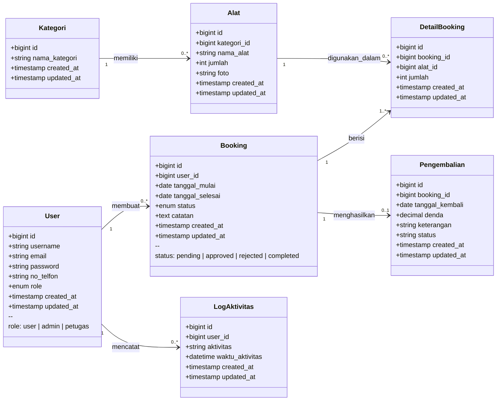

# Diagram Class — Sistem Peminjaman Alat

> Database: `db_peminjaman`

## Class Diagram (Mermaid)



---

## Penjelasan Relasi

| Relasi | Tipe | Keterangan |
|--------|------|------------|
| `Kategori` → `Alat` | One-to-Many | Satu kategori memiliki banyak alat |
| `User` → `Booking` | One-to-Many | Satu user dapat membuat banyak booking |
| `Booking` → `DetailBooking` | One-to-Many | Satu booking memiliki banyak detail alat |
| `Alat` → `DetailBooking` | One-to-Many | Satu alat dapat ada di banyak detail booking |
| `Booking` → `Pengembalian` | One-to-One | Satu booking memiliki satu pengembalian |
| `User` → `LogAktivitas` | One-to-Many | Satu user mencatat banyak log aktivitas |

---

## Deskripsi Entitas

### User
Menyimpan data pengguna sistem dengan tiga peran:
- `user` — peminjam alat
- `admin` — administrator
- `petugas` — staf lapangan

### Kategori
Pengelompokan alat berdasarkan jenis/kategori.

### Alat
Data alat yang tersedia untuk dipinjam, terhubung ke kategori dan memiliki informasi stok (`jumlah`).

### Booking
Transaksi peminjaman yang dibuat oleh user. Alur status:
```
pending → approved → completed
pending → rejected
```

### DetailBooking
Tabel pivot yang mencatat alat-alat beserta jumlahnya dalam satu booking.

### Pengembalian
Data pengembalian alat termasuk tanggal kembali dan perhitungan denda keterlambatan.

### LogAktivitas
Audit trail untuk mencatat semua aktivitas user di sistem.
